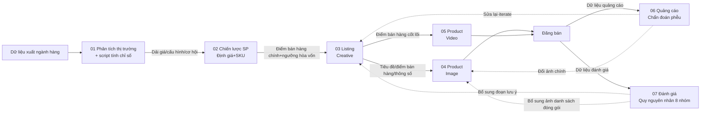

# AI Cross Border Ecommerce Agent Toolkit

**Bộ công cụ (toolkit) AI Agent cho vận hành thương mại điện tử xuyên biên giới** · *Turn cross-border ecommerce SOPs into reusable AI Agent workflows.*

[](./LICENSE)
[](./CHANGELOG.md)
[](#-toàn-cảnh-agent)

---

## Đây là gì

Biến **kinh nghiệm đúc kết trong SOP vận hành xuyên biên giới** thành **workflow AI Agent có thể nhân bản**: một Prompt chuẩn + một template đầu vào + một case study thật, ai cầm về cũng chạy ra được nội dung sản phẩm đủ chuẩn để đăng.

Không phải phần mềm, không phải SaaS, chỉ làm đúng bốn việc:

| Sản phẩm bàn giao | Mô tả |
|---|---|
| 📘 Phương pháp vận hành | Bảng tách đầy đủ từ chương SOP → module Agent |
| 🧠 AI Prompt | Vai trò / nhiệm vụ / hợp đồng đầu vào / hợp đồng đầu ra / tự kiểm tra |
| 🔁 Quy trình làm việc | Chạy theo thứ tự nào, điều kiện nào thì sang bước tiếp, điều kiện nào thì quay vòng về sửa lại |
| 📄 Template + case study | Định dạng đầu vào chuẩn + bản ghi chạy trọn vẹn trên sản phẩm thật (kèm số liệu kiểm tra lại) |

**Vì sao làm cái này**: cái khó của vận hành xuyên biên giới không phải là "không biết phải làm gì", mà là "biết nhưng không làm ra được output có chất lượng tối thiểu ổn định". Cùng một ngành hàng, người làm lâu năm viết tiêu đề một lần là chuẩn, người mới viết mười lần vẫn nhồi từ khóa. Mục tiêu của bộ công cụ này là cấu trúc hóa **quy tắc phán đoán** của người làm lâu năm, để output của AI luôn ổn định ở mức của họ.

---

## 📎 Nguồn tài liệu gốc

Phương pháp trong repo này được tách ra từ một cuốn cẩm nang vận hành nội bộ dài 38 trang, bản gốc được kèm luôn trong repo:

📄 **[《Khung tổng thể SOP vận hành Shopee Brazil》(PDF · 38 trang · 29.7 MB)](./docs/电商运营SOP总框架.pdf)**

Bảng đối chiếu từng mục giữa chương SOP và module Agent xem tại [`docs/00_Architecture_SOP_to_Agent.md`](./docs/00_Architecture_SOP_to_Agent.md).

> ⚠️ **Lưu ý**: File PDF này là **cẩm nang nội bộ gốc, chưa qua chỉnh sửa**, trong đó có những cách làm mà sàn cấm rõ ràng (như buff đơn ảo, dụ dỗ đánh giá, report sai sự thật, khai khống thông số, v.v.).
>
> **Cả 7 module Agent trong repo này đều không triển khai những cách làm đó**: các mục đã nhận diện cùng phương án thay thế tuân thủ (compliance) xem tại [`docs/03_Compliance_Guard.md`](./docs/03_Compliance_Guard.md), các mục không triển khai được ghi lại từng dòng tại [`docs/05_SOP_Gap_Register.md`](./docs/05_SOP_Gap_Register.md).
>
> Nói cách khác —— **file PDF này là「nguyên liệu」, không phải「sản phẩm」.** Output của repo này chỉ bao gồm các hướng đi tuân thủ.

---

## 🗂 Toàn cảnh Agent

7 module, **đã hoàn thành toàn bộ**.

| # | Agent | Tiếng Việt | Trách nhiệm trong một câu | Phiên bản |
|---|---|---|---|---|
| **01** | [Market Research Agent](./Agents/01_Market_Research_Agent/) | Phân tích thị trường | Đánh giá sơ bộ / quy mô thị trường / mức độ tập trung / dải giá (phát hiện vùng trũng) / tổ hợp cấu hình · **kèm script tính toán** | ✅ v0.4 |
| **02** | [Product Strategy Agent](./Agents/02_Product_Strategy_Agent/) | Chiến lược sản phẩm | Định vị / cấu hình / chốt điểm bán hàng chủ lực / mô hình định giá / 4 vai trò SKU · **ma trận biên lợi nhuận ròng/giá hòa vốn/dư địa voucher** · Skill hóa | ✅ v0.4 |
| 03 | [Listing Creative Agent](./Agents/03_Listing_Creative_Agent/) | Tạo nội dung sản phẩm | Phân loại từ khóa → tiêu đề → trang chi tiết → điểm bán hàng/thông số · **đếm ký tự thực tế/kiểm tra nguồn gốc thông số** · Skill hóa | ✅ v0.4 |
| 04 | [Product Image Agent](./Agents/04_Product_Image_Agent/) | Ảnh chính và ảnh chi tiết | Lên kế hoạch 9 ảnh → Prompt tạo ảnh → **kiểm tra tuân thủ ở mức pixel** · Skill hóa | ✅ v0.4 |
| 05 | [Product Video Agent](./Agents/05_Product_Video_Agent/) | Tạo video ngắn | Kịch bản → storyboard → Prompt video AI → lồng tiếng & phụ đề | ✅ v0.4 |
| 06 | [Advertising Optimization Agent](./Agents/06_Advertising_Optimization_Agent/) | Tối ưu quảng cáo | Chẩn đoán phễu 4 loại + tính ngưỡng hòa vốn + **hành động phân cấp P0/P1/P2** · Skill hóa | ✅ v0.4 |
| 07 | [Review Analysis Agent](./Agents/07_Review_Analysis_Agent/) | Phân tích đánh giá | Quy nguyên nhân theo 8 nhóm + nhận diện loại hiểu lầm → đề xuất vá trang chi tiết | ✅ v0.4 |

> **Bảy module này tạo thành một chuỗi hoàn chỉnh, và là vòng khép kín (closed loop)**:
>
> ```text
> 01 Phân tích thị trường ──► 02 Chiến lược SP ──► 03/04/05 Tạo nội dung ──► Đăng bán
> (làm gì)                    (làm thành ra sao)    (thể hiện thế nào)
>                                                                            │
>                                ┌───────────────────────────────────────────┘
>                                ▼
>              06 Chẩn đoán quảng cáo ─┐
>              07 Chẩn đoán đánh giá  ─┴──► Quay về 03/04 sửa ──► Kiểm tra lại ──► Đạt thì scale / chưa đạt thì chẩn đoán lại
> ```
>
> **Vì sao đánh số theo thứ tự này**: `01-02` cụm phân tích (chuỗi tiền đề) → `03-04-05` cụm sáng tạo (tạo nội dung) → `06-07` cụm vận hành (dữ liệu quay vòng về).
>
> ✅ Phương án đánh số đã được chốt. Kế hoạch ban đầu là `03` Listing / `04` Advertising / `05` Review / `06` Video (và không có số riêng cho Market Research và Product Strategy); repo này đã sắp xếp lại theo cụm công việc, lịch sử thay đổi xem tại [CHANGELOG](./CHANGELOG.md).

---

## 🚀 Bắt đầu nhanh

Không cần API key, không cần cài môi trường. **Ba file là chạy được.**

```text
Step 1  Sao chép template đầu vào trong Agents/<module>/templates/
Step 2  Điền thông tin sản phẩm của bạn (10 phút)
Step 3  Đưa「System Prompt」+「Task Prompt」+「template đã điền」cho bất kỳ LLM nào
Step 4  Tự kiểm tra từng mục theo docs/04_Result_Checklist.md, đạt hết là đăng
```

**Lần chạy đầu tiên, nên đi theo thứ tự này** (lấy Patinete Elétrico làm ví dụ, xem [`Examples/`](./Examples/)):



Ba điểm mấu chốt:

1. **01 có kèm script**. Các chỉ số (mức độ tập trung, dải giá, bảng chéo cấu hình) do `scripts/` tính, **Agent chỉ lo diễn giải** —— cái gì tính được thì đừng để model đoán.
2. **02 chốt điểm bán hàng, rồi 03/04/05 mới bắt tay vào làm**. Điểm bán hàng chính phải được chốt lại thành **đúng một câu**, nếu không ảnh chính sẽ in hai dòng chữ, video mở đầu nói hai chuyện, rốt cuộc khách chẳng nhớ cái nào.
3. **06 và 07 sẽ đưa kết luận quay vòng về 03/04**. Bước này là ranh giới giữa bộ công cụ này với các "công cụ tạo một lần rồi thôi" —— Listing tạo ra sẽ ngày càng chuẩn theo dữ liệu thực tế. Xem [`Examples/03_Closed_Loop/`](./Examples/03_Closed_Loop/).

---

## 📁 Cấu trúc thư mục

```text
AI-Cross-Border-Ecommerce-Agent-Toolkit/
├── SKILL.md                      # Điểm vào tổng của Skill dạng ô dù ⭐ (có thể cài cả thư mục thành một Skill)
├── README.md                     # Bạn đang ở đây
├── LICENSE  CONTRIBUTING.md  ROADMAP.md  CHANGELOG.md
│
├── docs/                         # Phương pháp vận hành
│   ├── 00_Architecture_SOP_to_Agent.md   # Bảng tổng tách chương SOP → Agent ⭐
│   ├── 01_Prompt_Design_Guide.md         # Chuẩn 5 thành phần của Prompt
│   ├── 02_Platform_Output_Spec.md        # Chỉ tiêu cứng về trường/số ký tự của từng sàn
│   ├── 03_Compliance_Guard.md            # Lằn ranh đỏ tuân thủ + viết lại các thao tác "xám" theo hướng tuân thủ ⭐
│   ├── 04_Result_Checklist.md            # Checklist tự kiểm tra khi bàn giao
│   ├── 05_SOP_Gap_Register.md            # Sổ đăng ký các mục SOP không triển khai (minh bạch hóa)
│   └── 电商运营SOP总框架.pdf              # Toàn văn cẩm nang nội bộ gốc (38 trang, chưa chỉnh sửa)
│
├── Agents/                       # Các module AI Agent
│   ├── README.md                 # Mục lục module + hợp đồng bàn giao
│   ├── 01_Market_Research_Agent/              ✅ v0.4 Skill hóa
│   │   ├── SKILL.md    Điểm vào để Agent gọi trực tiếp ⭐
│   │   ├── scripts/    shaduola_parser · market_metrics · make_sample ⭐
│   │   ├── samples/    Dữ liệu mẫu (kèm kết quả kỳ vọng, tái hiện được)
│   │   ├── prompts/    00_system · 01_category_precheck · 02_market_analysis
│   │   ├── templates/  input_category_research · output_market_analysis
│   │   └── examples/   patinete_eletrico_market.md
│   ├── 02_Product_Strategy_Agent/             ✅ v0.4 Skill hóa
│   │   ├── SKILL.md    Điểm vào để Agent gọi trực tiếp ⭐
│   │   ├── references/ pricing-rules (công thức và cách tính) ⭐
│   │   ├── scripts/    sku_pricing (ma trận biên lợi nhuận ròng/giá hòa vốn/giá mục tiêu/dư địa voucher) + platform_fees.json (preset biểu phí 5 sàn) ⭐
│   │   ├── prompts/    00_system · 01_product_decision · 02_pricing_and_sku
│   │   ├── templates/  input_strategy_brief · output_product_requirement
│   │   └── examples/   patinete_eletrico_strategy.md · sample-skus.csv
│   ├── 03_Listing_Creative_Agent/             ✅ v0.4 Skill hóa
│   │   ├── SKILL.md    Điểm vào để Agent gọi trực tiếp ⭐
│   │   ├── references/ platform-title-rules (thẻ quy tắc tiêu đề) ⭐
│   │   ├── scripts/    title_lint (đếm ký tự thực tế/từ cấm/nhồi từ khóa) · spec_consistency (nguồn gốc thông số) ⭐
│   │   ├── prompts/    00_system · 01_keyword_to_title · 02_description_builder · 03_compliance_guard
│   │   ├── templates/  input_product_brief · output_listing_pack
│   │   └── examples/   powerbank_20000mah.md · spec_table.csv
│   ├── 04_Product_Image_Agent/                ✅ v0.4 Skill hóa
│   │   ├── SKILL.md    Điểm vào để Agent gọi trực tiếp ⭐
│   │   ├── references/ platform-shopee · platform-mercadolivre · platform-amazon · scenarios-9grid
│   │   ├── scripts/    check_main_image (kiểm tra tuân thủ ở mức pixel + --fix) ⭐
│   │   ├── prompts/    00_system · 01_image_plan_9grid · 02_image_prompt_generator
│   │   ├── templates/  input_image_brief · output_image_prompt_pack
│   │   └── examples/   pet_carrier.md
│   ├── 05_Product_Video_Agent/                ✅
│   │   ├── SKILL.md + references/video-specs.md (thẻ quy chuẩn video theo sàn)
│   │   ├── scripts/    video_timing.py        # Kiểm tra tất định thời lượng/phụ đề
│   │   ├── prompts/    00_system · 01_script_and_storyboard · 02_ai_video_and_voice
│   │   ├── templates/  input_video_brief · output_video_pack
│   │   └── examples/   air_fryer.md + narration_airfryer.txt
│   ├── 06_Advertising_Optimization_Agent/     ✅ v0.4 Skill hóa
│   │   ├── SKILL.md    Điểm vào để Agent gọi trực tiếp ⭐
│   │   ├── references/ metrics · diagnosis · playbooks · actions ⭐
│   │   ├── scripts/    ad_metrics (ngưỡng hòa vốn/CPC chịu được/phân cấp P0-P2, chỉ dùng thư viện chuẩn) ⭐
│   │   ├── prompts/    00_system · 01_funnel_diagnosis · 02_budget_roi_model
│   │   ├── templates/  input_ad_data · output_ad_action_plan
│   │   └── examples/   powerbank_20000mah_ads.md · sample-ad-report.csv
│   └── 07_Review_Analysis_Agent/              ✅
│       ├── SKILL.md (phân loại giao cho model, đếm số giao cho script)
│       ├── scripts/    review_stats.py        # Tổng hợp quy nguyên nhân/tỷ lệ sửa được/xếp hạng điểm bán hàng
│       ├── prompts/    00_system · 01_classify_and_attribute · 02_misunderstanding_detector
│       ├── templates/  input_review_batch · output_review_insights
│       └── examples/   electric_scooter_reviews.md + sample-reviews.csv
│
├── Templates/                    # Thư viện template dùng chung giữa các module
│   ├── product_brief_template.md         # Hợp đồng giao tiếp giữa các module ⭐
│   ├── keyword_analysis_template.md      # Bản nháp 3 bảng xếp hạng từ khóa
│   ├── cost_pricing_template.md          # Mô hình định giá (kiểm tra lại được)
│   └── output_qa_checklist.md            # Checklist tự kiểm tra bản in được
│
└── Examples/                     # Thư viện case study end-to-end trên sản phẩm thật
    ├── 01_Patinete_Eletrico_500W/        # Flagship: toàn chuỗi 03→04→05
    ├── 02_Thermal_Bag/                   # Chế độ iterate: chẩn đoán quảng cáo→sửa lại
    └── 03_Closed_Loop/                   # Vòng khép kín: chẩn đoán→quay vòng về→kiểm tra lại ⭐
```

Sản phẩm trong các case study (năm sản phẩm theo yêu cầu của bản hướng dẫn thực hiện): Electric Scooter · Power Bank · Pet Carrier · Air Fryer · Thermal Bag ✅

Mỗi module Agent cố định bốn thành phần con: `prompts/` + `templates/` + `examples/` + `README.md`.

---

## 📱 Sàn được hỗ trợ

| Sàn | Trạng thái | Giới hạn tiêu đề | Quy chuẩn ảnh chính | Ngôn ngữ output |
|---|---|---|---|---|
| **Shopee** | ✅ Hỗ trợ hạng nhất | 120 ký tự (30 ký tự đầu có trọng số cao nhất) | Nền trắng, tối đa 9 ảnh | PT-BR / EN / ngôn ngữ bản địa |
| **Mercado Livre** | ✅ Hỗ trợ hạng nhất | 60 ký tự | Nền sạch (trắng/màu trơn/bối cảnh thật tùy ngành hàng), chủ thể chiếm 85–95%, ≥1200×1200 | PT-BR / ES |
| Amazon | 📄 Đã khớp các trường | 200 ký tự (khuyến nghị 80) | Nền trắng tinh, ≥1000×1000 | EN |
| TikTok Shop | 📄 Đã khớp các trường | Tùy site | Ưu tiên khung dọc 9:16 | Ngôn ngữ bản địa |
| Shopify | 📄 Đã khớp các trường | Khuyến nghị 70 | Không giới hạn cứng | EN / ngôn ngữ bản địa |

Quy chuẩn trường chi tiết xem tại [`docs/02_Platform_Output_Spec.md`](./docs/02_Platform_Output_Spec.md). **Mọi chỉ tiêu cứng đều lấy quy định hiện hành trong Seller Center của sàn làm chuẩn, vui lòng kiểm tra lại trước khi đăng.**

---

## 🧭 Nguyên tắc thiết kế

1. **Ưu tiên output bằng tiếng mẹ đẻ** —— tiêu đề trên Shopee Brazil phải đọc như người Brazil viết. Listing dịch thẳng từ tiếng Anh có CTR thấp về mặt cấu trúc, nên Prompt bắt buộc dùng cách diễn đạt PT-BR tự nhiên, chứ không phải "giọng văn dịch".
2. **Hợp đồng hóa đầu vào** —— mỗi Prompt đều khai báo "thiếu trường nào thì không được xuất nội dung tương ứng". Thà báo lỗi, còn hơn bịa thông số.
3. **Tuân thủ đặt trên chuyển đổi** —— mọi thao tác dính tới khai khống thông số, từ khóa thương hiệu, quảng cáo phóng đại đều bị Prompt **chặn cứng**, không phải "khuyến nghị". Chi tiết xem [`docs/03_Compliance_Guard.md`](./docs/03_Compliance_Guard.md).
4. **Kiểm chứng được** —— mỗi module khi bàn giao đều kèm một checklist tự kiểm tra, tick đủ từng mục mới tính là xong. Output đúng hay sai không dựa vào cảm tính.

---

## ⚠️ Tuyên bố tuân thủ

Bộ công cụ này chỉ phục vụ **nâng cao hiệu quả vận hành một cách hợp pháp và tuân thủ**. SOP gốc có một số ít thao tác "xám" mà sàn cấm rõ ràng (như giao dịch ảo/buff đơn ảo, tổ chức report sai sự thật, khai khống thông số và quảng cáo phóng đại). Những nội dung này **đã được nhận diện trong repo và viết lại thành phương án thay thế tuân thủ**:

- Bảng đối chiếu viết lại → [`docs/03_Compliance_Guard.md`](./docs/03_Compliance_Guard.md)
- Ghi lại từng mục không triển khai (giải thích vì sao không làm, phương án thay thế nằm ở đâu) → [`docs/05_SOP_Gap_Register.md`](./docs/05_SOP_Gap_Register.md)

Nội dung tạo ra bằng bộ công cụ này, **vui lòng tự đối chiếu quy định mới nhất của sàn trước khi đăng**. Tác giả không chịu trách nhiệm cho các hình phạt tài khoản do sử dụng sai quy định.

---

## 🗺 Lộ trình

| Phiên bản | Nội dung |
|---|---|
| **v0.1** | 3 Agent sáng tạo (03/04/05) + tài liệu phương pháp + thư viện case study |
| **v0.2** | 2 Agent vận hành (06 quảng cáo / 07 đánh giá) + case study vòng khép kín |
| **v0.3** | 2 Agent phân tích (01 thị trường / 02 chiến lược) + **script phân tích dữ liệu và tính chỉ số** (hiện tại) |
| **v1.0** | Nối thông toàn bộ workflow, xuất gói nội dung để đăng bán một chạm |
| V2 | Kết nối API của sàn (Shopee / Mercado Livre) để tự động kéo dữ liệu |
| V3 | Ứng dụng web, chạy workflow trực quan |
| V4 | Nâng cấp thành hệ thống Agent tự động (chạy theo lịch + tối ưu vòng khép kín) |

Chi tiết xem [`ROADMAP.md`](./ROADMAP.md).

---

## 🤝 Đóng góp

Hoan nghênh bổ sung bảng chiều cấu hình cho ngành hàng mới, quy định sàn cho thị trường mới, và case study thật. Vui lòng đọc [`CONTRIBUTING.md`](./CONTRIBUTING.md) trước.
**Case study gửi lên bắt buộc phải ẩn danh**: không chứa tên shop thật, tài khoản, thông tin người mua, hay từ khóa thương hiệu chưa được cấp phép.

## 📄 License

[MIT](./LICENSE)
